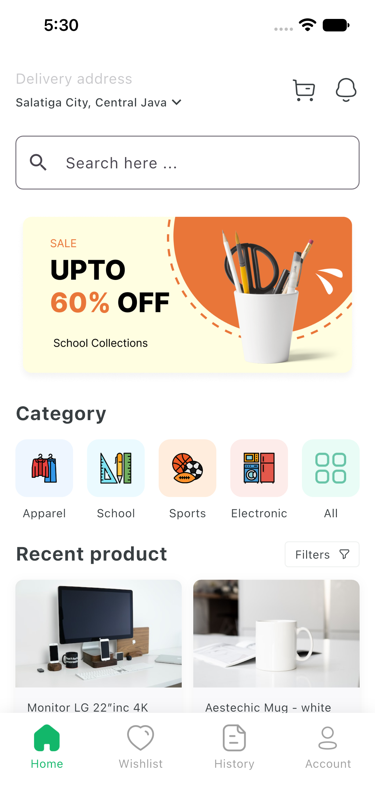

# eco

A Flutter e-commerce demo application built with `flutter_screenutil`. It showcases a home screen with delivery address, search, banner, product categories, and a recent products grid, plus a custom bottom navigation bar.

## Features

- Home screen with header (delivery address, cart and notification icons)
- Search bar
- Promotional banner
- Category list (Apparel, School, Sports, Electronic, All)
- Recent products grid with add-to-cart
- Custom bottom navigation bar (Home, Wishlist, History, Account)
- Responsive layout using `flutter_screenutil` (design size 390×844)

## Screenshots

### Home Screen



## Project Structure

```text
lib/
├── core/
│   ├── routes/          # App routes and router
│   ├── theme/           # Colors, styles, images, fonts
│   └── widgets/         # Reusable widgets (search bar, bottom nav, add to cart)
├── feature/
│   └── home/
│       ├── home_screen.dart
│       └── widgets/     # Header, body, category, recent products
└── main.dart
```

## Dependencies

- `flutter` (SDK)
- `cupertino_icons: ^1.0.8`
- `flutter_screenutil: ^5.9.3`

Dev dependencies:

- `flutter_test` (SDK)
- `flutter_lints: ^6.0.0`

## Assets

- `assets/images/` — banners and product images
- `assets/icons/` — navigation and category icons
- `assets/app_screen/` — screenshots

## Getting Started

### Prerequisites

- [Flutter SDK](https://docs.flutter.dev/get-started/install) (Dart `^3.12.0`)
- A device or emulator

### Install

```bash
flutter pub get
```

### Run

```bash
flutter run
```

### Analyze

```bash
flutter analyze
```

## Routes

| Route | Screen |
|-------|--------|
| `/`   | HomeScreen |

## Notes

- The app uses a single route (`/`) and an `IndexedStack` to switch between bottom navigation tabs.
- Wishlist, History, and Account tabs currently show placeholder content.

## License

This project is a demo/learning project. Add your preferred license here.
